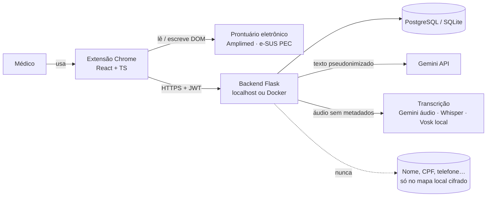
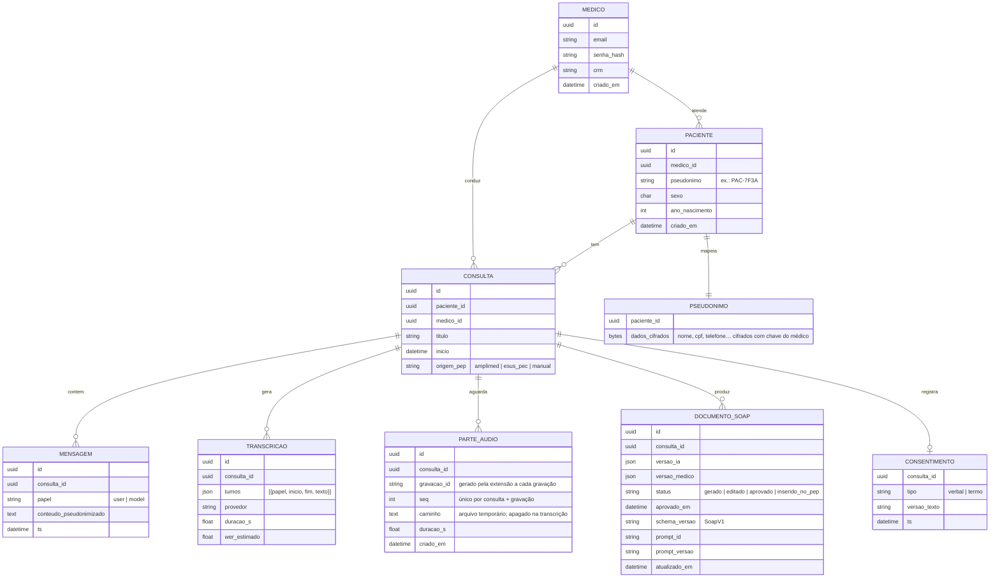
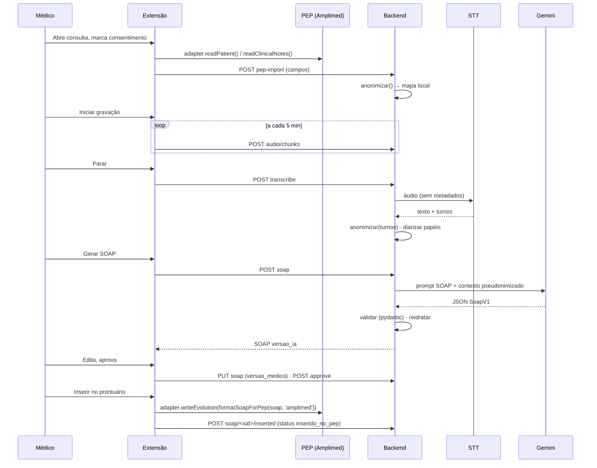

# 05 — Arquitetura alvo da v5.0 e decisões (ADRs)

## 1. Visão de contexto



O desenho mantém a topologia dos quatro ciclos anteriores (extensão ⇄ Flask ⇄ Gemini) e troca as partes frágeis: banco JSON → relacional; sem auth → JWT; Google SR não oficial → provedor configurável; anonimização de nomes → pseudonimização completa; chat livre → chat + SOAP estruturado; scraping fixo → adaptadores de PEP.

## 2. Containers e módulos

### 2.1 Extensão (`front/copmed-extension`)

```
src/
  app/            App.tsx (roteamento de abas, ≤ 200 linhas)
  features/
    auth/         login, token no chrome.storage.session
    patients/     lista, criação, seleção
    consultation/ chat, recomendações, histórico
    recording/    MediaRecorder, chunks, consentimento, timer
    soap/         SoapEditor (S/O/A/P + CID-10), diff IA×médico, inserir no PEP
    export/       PDF/MD
  pep/            PepAdapter (interface), amplimed.ts, esus-pec.ts, registry.ts
  api/            client.ts (fetch com JWT e fila offline), types.ts (gerados do OpenAPI)
  shared/         ui, hooks, formatSoapForPep.ts
public/
  manifest.json   host_permissions restritos aos PEPs; content.js só nesses domínios
  offscreen.html  documento offscreen: grava e envia o áudio em partes com o popup fechado
  content.js      registra adaptadores, botão flutuante, ponte de mensagens
  background.js   fila offline, alarmes, sincronização; cria o offscreen e guarda o estado da gravação
```

Regras: nenhum componente acima de 300 linhas; `App.tsx` só compõe; lógica de PEP não conhece React; lógica de API não conhece DOM.

### 2.2 Backend (`API/`)

```
API/
  app.py                create_app(): blueprints, CORS restrito, JWT, logging
  config.py             pydantic-settings (reaproveita o arquivo existente)
  blueprints/
    auth.py             /api/auth/register, /login, /refresh
    patients.py         /api/patients
    consultations.py    /api/consultations/<id>/(messages|history|pep-import|export)
    audio.py            /api/consultations/<id>/audio/chunks, /transcribe
    soap.py             /api/consultations/<id>/soap, /recommendations
  services/
    anonymizer/         regex.py, ner.py, pseudonym_map.py, anonymize()
    llm/                provider.py (interface), gemini.py, prompts/ (PT-BR, versionados)
    transcription/      provider.py, gemini_audio.py, whisper.py, vosk_local.py, diarize.py
    soap/               schema.py (SoapV1), diff.py (IA×médico, B44), gerador.py + prompts/soap_v1.txt + material.py (B40), cid10.py (tabela embarcada)
    pdf.py, export.py
  models/               SQLAlchemy + Alembic (migrations/)
  scripts/              download_models.py, migrate_json_db.py, seed_dev.py
  tests/                unit/, integration/, fixtures/ (páginas HTML de PEP, áudios curtos)
eval/
  cases/                20 casos sintéticos (json)
  audio/                10 wavs + gabaritos
  run_eval.py           WER, completude, CID-10, latência, custo → relatório md
```

## 3. Modelo de dados



## 4. Contrato da API (resumo; OpenAPI completo gerado pelo backend em `/api/openapi.json`)

| Método | Rota | Entrada | Saída |
|---|---|---|---|
| POST | `/api/auth/register` | email, senha, crm | 201 |
| POST | `/api/auth/login` | email, senha | access, refresh |
| GET/POST | `/api/patients` | — / {sexo, ano_nascimento, identificacao?} | lista / paciente (pseudônimo) |
| POST | `/api/patients/<id>/consultations` | titulo?, origem_pep?, importar_de?[] | consulta |
| POST | `/api/consultations/<id>/consent` | tipo, versao_texto | 201 |
| POST | `/api/consultations/<id>/pep-import` | {pep_origem, source_url?, created_at?, campos: {peso, …, anamnese, …}} | resumo do que foi registrado (nomes dos campos, nunca o conteúdo) |
| POST | `/api/consultations/<id>/messages` | texto | resposta do LLM (reidratada) |
| POST | `/api/consultations/<id>/pdf` | multipart pdf | resumo + resposta |
| POST | `/api/consultations/<id>/audio/chunks` | multipart `audio_file` (wav ≤ 5 min), `recording_id`, `seq` | 202 `{seq, duration, replaced, received[]}`; reenviar a mesma `seq` substitui a parte |
| POST | `/api/consultations/<id>/transcribe` | `recording_id`, `total_chunks?`, provedor? | transcrição com turnos + `chunks {received, missing, failed}`; apaga o áudio das partes |
| POST | `/api/recommendations` (B38; mantida a rota existente, US020-CA001) | patient_id, consultation_id, janela_min? (1–120, padrão 5) | itens[] {tipo, texto} (≤ 5, ≤ 20 palavras), janela_min, transcricoes_usadas |
| GET | `/api/cid10?q=&limit=` (B42) | q (início do código ou palavras da descrição), limit 1–100 (padrão 20) | `results[] {code, description}` da tabela CID-10 embarcada (DATASUS), código exato e prefixo primeiro; < 100 ms |
| POST | `/api/consultations/<id>/soap` (B40) | — | 201 com o SOAP gerado (versao_ia, reidratado), `tentativas`; 400 sem material; 502 com `errors` se inválido após 1 retry; 429 se a cota da IA esgotar |
| GET | `/api/consultations/<id>/soap` (B44) | — | SOAP mais recente: `versao_ia`, `versao_medico`, `atual` e `diff` por seção (null sem edição) |
| PUT | `/api/consultations/<id>/soap/<sid>` | versao_medico (SoapV1; B44) | SOAP com `diff`; 400 com `errors` por campo; 409 se aprovado |
| POST | `/api/consultations/<id>/soap/<sid>/approve` (B53; botão Aprovar do B43) | — | SOAP `aprovado`; 409 se já inserido no PEP |
| POST | `/api/consultations/<id>/soap/<sid>/inserted` (B53) | pep (`amplimed` \| `esus-pec`) | SOAP `inserido_no_pep`; 409 se não aprovado ou já inserido |
| GET | `/api/consultations/<id>/export?format=` | pdf \| md | arquivo |
| GET | `/api/health` | — | versão, provedores ativos (**sem chaves**) |

Todas as rotas exigem `Authorization: Bearer <jwt>` exceto `register`, `login`, `health`.

## 5. Fluxo principal — "Da conversa ao prontuário"



## 6. Decisões de arquitetura (ADRs)

Formato curto. Cada ADR ganha um arquivo em `docs/adr/` no repositório quando aceito pela equipe.

### ADR‑01 — Manter Flask + extensão React/TS
**Contexto:** três turmas conhecem essa stack; a trilha privada usa Next.js/Supabase.
**Decisão:** manter Flask e React, refatorando em blueprints e features. Não migrar para Next.js.
**Consequência:** continuidade de conhecimento; código legado reaproveitado; o backend continua local ao médico (bom para LGPD).

### ADR‑02 — Banco relacional com SQLAlchemy + Alembic
**Contexto:** JSON único (D‑10).
**Decisão:** SQLite em desenvolvimento, PostgreSQL 16 em Docker; modelos SQLAlchemy 2.x; migrações Alembic; script de migração do JSON.
**Alternativas rejeitadas:** manter JSON com lock (não resolve concorrência nem PII); MongoDB (sem ganho para o modelo relacional simples).

### ADR‑03 — Pseudonimização reversível local
**Contexto:** D‑11; LGPD exige minimização e o médico precisa ver nomes.
**Decisão:** `anonymize()` em duas camadas (regex determinística + NER spaCy) substitui por tokens estáveis por consulta; o mapa fica na tabela `pseudonimo`, cifrada (Fernet/AES‑GCM) com chave derivada da senha do médico; a resposta é reidratada só na exibição.
**Consequência:** payloads externos sem PII verificáveis por teste; custo: nomes de doenças homônimos a pessoas podem ser mascarados (mitigar com lista de exceções médicas).

### ADR‑04 — Provedor de transcrição configurável, pago por padrão
**Contexto:** D‑04; qualidade da API gratuita é imprevisível; Vosk small‑pt tem WER alto.
**Decisão:** interface `TranscriptionProvider`; implementação padrão **Gemini áudio** (já é a API contratada; devolve transcrição com marcação de falantes em uma chamada); alternativa **Whisper large‑v3 via Groq**; **Vosk local** como fallback offline (com aviso de qualidade). Diarização: papéis atribuídos pelo provedor quando disponível, senão pela heurística de vetor de voz já existente (com `MODO_TESTE_SOZINHO` removido).
**Decidido pelo cliente em 15/09/2026:** Gemini áudio é o provedor padrão; Whisper/Groq fica como comparação opcional no eval. Quem paga a chave segue pendente (P2, doc 10).
**Atualização 09–15/11/2026 (PO):** o padrão passou a ser **Whisper large‑v3 via Groq** (plano gratuito, menor latência no piloto); Gemini áudio fica como alternativa com marcação de falantes e Vosk como fallback local. No LLM, **Claude Haiku 5.5** é o padrão com chave fornecida pelo PO (exceção à política de custeio, `docs/12` §4) e Gemini é a reserva automática (`ProvedorComReserva`).

### ADR‑05 — SOAP como saída estruturada validada
**Contexto:** hoje a saída é markdown livre com formato instável.
**Decisão:** esquema `SoapV1` em pydantic; chamada ao Gemini com `response_mime_type=application/json` + `response_schema`; reprocessamento com 1 tentativa se inválido; prompts em PT‑BR versionados em arquivos; sem pedido de referências ou percentuais.
**Consequência:** front simples; testes de contrato; avaliação automática possível.

### ADR‑06 — Adaptador por PEP no content script
**Contexto:** seletores espalhados e duplicados (D‑01); trilha privada provou o padrão com 9 sistemas.
**Decisão:** interface `PepAdapter` com `detect/readPatient/readClinicalNotes/writeEvolution`; registro central; fixtures HTML por PEP para testes; `host_permissions` só dos domínios suportados.
**Consequência:** cada PEP novo é um arquivo + fixture + teste.

### ADR‑07 — Autenticação JWT própria
**Contexto:** D‑14; backend roda no computador do médico ou em servidor da clínica.
**Decisão:** e‑mail + senha (argon2), JWT de 15 min + refresh de 7 dias em `chrome.storage.session`; sem OAuth nesta versão.
**Alternativa rejeitada:** Google OAuth via `chrome.identity` (exige client id publicado e complica o Docker local).

### ADR‑08 — CI obrigatório e branch protection
**Decisão:** GitHub Actions com `pytest --cov`, `ruff`, `eslint`, `tsc`, `vite build`; PR template com checklist LGPD; `develop` protegido; `main` só recebe releases.

### ADR‑09 — Repositório único em organização GitHub
**Contexto:** D‑21.
**Decisão:** criar organização `copilot-medico` (ou similar) com repositório `copilot-medico`; importar o histórico da branch `develop` da Equipe 6 (que já contém o da Equipe 4). Owners: Dr. Rui + professor; alunos como maintainers do semestre.

### ADR‑10 — Escopo do sistema gerenciador web (`front/copmed-web`)
**Contexto:** o Grupo 2 (2026.1) entregou um web app React com login, pacientes, aprovação de médicos e cinco telas placeholder (D‑31). Decisão P10 pendente desde 09/10.
**Decisão (PO, 15/10/2026):** a web **mantém apenas login, cadastro/listagem de pacientes e aprovação de médicos pelo admin**, integrados à mesma autenticação da API. As telas Agenda, Consulta, Atendimentos, Histórico e Ajustes e os cards fixos do Dashboard são removidos. Nenhum item novo de web entra no backlog até M4 além de manutenção.
**Alternativas rejeitadas:** evoluir Consulta/Histórico na web (duplica o esforço com a extensão); congelar (perde o painel do admin, necessário para aprovar médicos).
**Consequência:** a extensão continua o produto principal; a web é o painel administrativo e a visão do prontuário. Ver `docs/12`, P10.

## 7. Prompts (diretrizes)

- Português do Brasil, persona "assistente de documentação clínica", nunca "diagnostica".
- Sempre termina com o aviso de validação médica (mantido dos ciclos anteriores).
- SOAP: instruções explícitas por seção; CID‑10 sugerido com `confianca` qualitativa; `pendencias` lista o que faltou perguntar.
- Recomendações: até 5 itens, ≤ 20 palavras cada.
- Proibido: inventar exames já feitos, valores de exames ausentes, referências bibliográficas com link.
- Cada prompt tem `id` e `versao`; a versão é gravada junto do SOAP gerado.

## 8. Segurança (resumo; detalhes no doc 08)

- CORS restrito à origem da extensão; rate limit por médico.
- Chaves de API só em variáveis de ambiente; `/api/health` nunca expõe chaves (lição da trilha privada).
- Áudio apagado após transcrição; logs sem conteúdo clínico.
- Dependências travadas (`requirements.txt` com versões; `npm ci`).

### Contrato `pep-import` (B07)

Implementado em `API/backend/pep_import.py`; especificação OpenAPI 3.1 em `GET /api/openapi.json` (pública).

- `pep_origem` (obrigatório): `amplimed`, `esus-pec` ou `outro`.
- `campos`: 8 sinais vitais (`peso, altura, imc, tempe, freqres, freqcar, pas, pad`) e 4 notas
  (`anamnese, exame_fisico, conclusao_diagnostica, lista_problemas`). Chave desconhecida → 400;
  campo vazio é ignorado; ao menos um campo preenchido. Limites: 20 caracteres (sinal vital) e 20 000 (nota).
- A consulta é obrigatória. Na rota canônica ela vem no caminho; o paciente é deduzido dela.
- Aliases mantidos: `POST /api/extension/extracted-data` e `POST /api/extracted-data` (**deprecated**).
  Ambos exigem `patient_id` + `consultation_id` no corpo e aceitam o corpo tipado ou o formato livre legado
  (`extracted_content` / `extracted_data`).
- O item gravado em `extension_data` tem `type: "pep_import"`, `pep_origem` e `content` plano.

